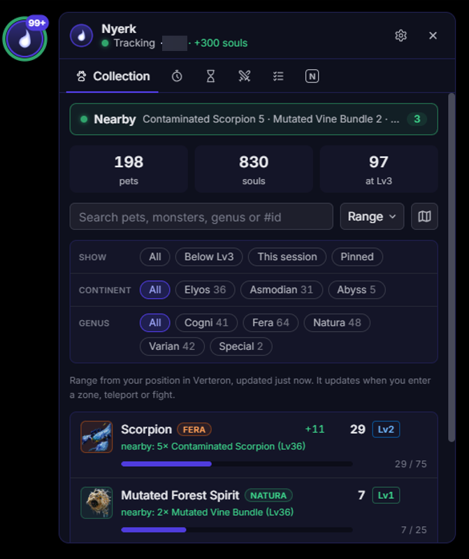
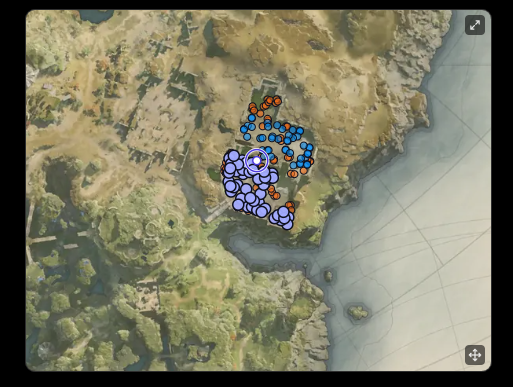
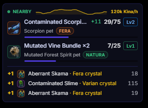

# Nyerk

A Windows overlay for Aion 2: it counts your Pet Collection souls as they drop, tracks your daily
and weekly tasks, and times the game's events and field bosses, all without touching the game.

<p align="center">
  
  
  
</p>

- **Live soul counts:** every soul is counted the moment it drops, with level-ups (5 → 25 → 75)
  and the genus crystals that maxed (Lv3) pets give instead. Your whole collection syncs from the
  game at login, so it always matches the Pets menu.
- **In-game HUD:** a small click-through overlay with nearby soul monsters, this fight's pets, a
  feed of drops and your Kina per hour. It clears itself between fights.
- **Collection panel:** every pet with its genus, level and progress. Search, combine filters,
  sort by what's nearest you, and pin pets to the HUD.
- **Maps and minimap:** see where each soul drops, and every pet your filters leave in your zone.
  Shrink the map into a small minimap that stays over the game.
- **Task List:** daily, weekly, event and Season tasks for each character. Keys, tickets and
  Odyle Energy are read from the game, with when each stock fills.
- **Timers:** the game's events (Shugo Festival, the Black Cloud Merchant, rifts, the siege…) and
  the field bosses of Verteron, Altgard and Lower Reshanta, with optional alerts. Field boss times
  are shared between players, so they stay right even when you haven't opened the map.
- **PvP Log:** the kills around you, with a Server vs Server score against each enemy server.
- **Black Cloud Merchant:** when you open one of its tabs, a window lists the pets it sells that
  you haven't maxed, and where their soul monsters spawn.
- **Make it yours:** the panel can be resized, and Timers, Task List and PvP Log are addons you can
  switch off in Settings → Addons.
- **One collection per character:** switching to an alt shows that character's pets and tasks.
- **Stays out of the way:** it sits in the tray and sleeps while Aion 2 is closed, waking when the
  game starts.
- And whatever else I randomly find useful while I play Aion 2. :D

[Nyerk Discord](https://discord.gg/tjJkjDzbbU) - Timers and support.

## How it works

The tracker **only listens** and functions the exact same as popular DPS Meters used in Aion 2. It reads the game's network traffic passively through
[Npcap](https://npcap.com). It never sends anything to the game
or its servers, never reads or changes the game's memory, and sends no input.

The app talks only to **nyerk.app**: to check for updates, and (unless you switch off "Share
field boss timers") to send the field boss times your map shows and get other players' back. That
carries your game server's id and an anonymous hash of your PC, never your character's name or
position.

## Install

1. Install [Npcap](https://npcap.com) (the default options are fine).
2. Download `Nyerk-Setup-<version>.exe` from the
   [latest release](../../releases/latest) and run it. It installs for your Windows account only.
   The installer is not code-signed, so Windows may show "Windows protected your PC": choose
   **More info → Run anyway**.
3. Start the tracker **before you log in** to your character, so it picks up your collection.

The overlay draws over **borderless or windowed** mode, not exclusive fullscreen. The app checks
for updates by itself and asks before installing one.

## Build from source

Needs Windows, [Python 3.12+](https://www.python.org), [Node.js 24](https://nodejs.org) and Npcap.

```bash
python -m venv .venv
```

```bash
.venv\Scripts\python -m pip install -e . pyinstaller
```

```bash
cd app && npm install && npm run dist
```

The installer is written to `app/dist/`. To run without installing, use `npm run build` and then
start Electron from `app/` (`npx electron .`).

## Privacy

Nyerk itself sends data only to nyerk.app:

- **Your IP address**, which every connection carries, for the field boss timers and update checks.
- **The app's version**, which every request names.
- **A machine identifier** for the crowd-sourced field boss timers: a salted hash of your Windows
  machine id, made on your PC, so the id itself never leaves it.
- **Your game server and zone ids, and the field boss times your map shows**, for the
  crowd-sourced timers.

Turn off **Share field boss timers** in the app's Timers tab to stop sending the machine identifier
and the timers; the app then uses only your own map. Update checks never carry either.

Nothing else from the game is sent: not your character's name, position or account.

Addons you install may connect to other sites; each addon lists the sites it uses.

To have your data deleted, open a [GitHub issue](../../issues) or ask in the
[Nyerk Discord](https://discord.gg/tjJkjDzbbU).

## Code signing policy

Free code signing provided by [SignPath.io](https://about.signpath.io/), certificate by
[SignPath Foundation](https://signpath.org/).

Installers are built from this repository by GitHub Actions and signed only after a maintainer
approves each signing request.

- Committers and reviewers: [xCROv](https://github.com/xCROv)
- Approvers: [xCROv](https://github.com/xCROv)

What the app sends, and to whom: see [Privacy](#privacy).

## Credits

- Monster names (`data/npcs_en.json`) come from
  [taengu/A2Tools-DPS-Meter](https://github.com/taengu/A2Tools-DPS-Meter), licensed GPL-3.0.
- Pet names, genus, portraits, spawn locations and zone maps come from
  [questlog.gg](https://questlog.gg/aion-2/en/db/pets).
- Aion 2 and its game data and art belong to NCSoft. This project is not affiliated with or
  endorsed by NCSoft or questlog.gg.

## License

[GPL-3.0](LICENSE). It includes GPL-3.0 data from A2Tools-DPS-Meter (see Credits).

## Disclaimer

Use at your own risk. The tracker is passive, but whether third-party tools are allowed is up to
the game's Terms of Service.
